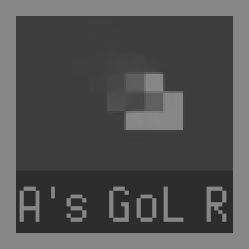

# Anstro's Game of Life Remake - Raylib edition

## An implementation of Conway's Game of Life in C/C++ using Raylib!

## Conway's Game of Life

Conway's Game of Life is a game of cellular automata. It is a zero-player game. Meaning that it does not require any player input. The game consists of grid of "cells" that can either be live or be dead. The game advances based on the state of neighoring cells. The game is dependent on the initial conditions.

## Rules

- If a cell is live and there are less than 2 or more than 3 live neighoring cells, the cell will die.
- If a cell is dead and there are exactly 3 live neighoring cells, the cell will be revived into living.

These simple rules define a complex behavior.

## My Implementation

### Cell grid

An array with a specific size is initialized. Each cell has four different states:

- A cell can be *live*
- A cell can be *dead*
- A cell can be *kill* which means the cell will be *dead* in next generation
- A cell can be *born* which means the cell will be *live* in next generation

The propose of the last two is to calculate the generation messing up synchronous updates. That means the cells should be updated based on with previously calculated cell's previous state rather than currently calculated state.

### Technical twist

The cell can also have *fade* state. Due to the arrangement of the cell state values

- `live = 0`
- `born = 1`
- `kill = 2`
- `dead = 3`
- `fade = 255`

Any state after *dead* is also considered dead. The values after *dead* determines the fading color of the cell. the *fade* is the final color of the faded cell.

### Calculations

The cells in the array are calculated one by one (slow). To prevent messy calculations, by which I mean the cell rely on the previous cell's state, the cell's *live* or *dead* state is also determined by *kill* or *born* state respecively.

Once the cells are calculated by the rules mensioned above, another loop is kept in charge that replaces every *kill* and *born* state with *dead* and *live* respectively.

## Installation

Currently the only way to install is to clone the repository and build it:
- Clone the reposiroty
- Get [raylib](https://github.com/raysan5/raylib/) setup
- Compile the [main.c](main.c) file
- That's it!

## License

Copyright (c) Anstro Pleuton

This project is licensed under MIT License, see [LICENSE](LICENSE) file or [MIT License](https://opensource.org/license/mit/)

NOT ALL FILES BELONG TO ME. [style.rgs](style.rgs) AND [styles/](styles/) ARE FROM [raygui](https://github.com/raysan5/raygui) AND BELONGS TO [Ramon Santamaria (@raysan5)](https://github.com/raysan5) AND THEIR RESPECTIVE COPYRIGHT HOLDERS (e.g. the font).
